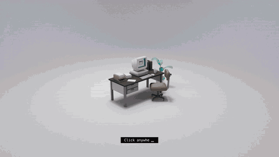

# aayushagrawal.in

A 3D portfolio for **Aayush Agrawal**. Walk up to a retro computer and use **AayushOS 98**, a small desktop with my projects, experience, resume and contact.

Live at **[aayushagrawal.in](https://aayushagrawal.in)** · Minimal version at **[aayushagrawal.codes](https://aayushagrawal.codes)**



## How it works

- **3D scene** (`src/`): Three.js scene of a desk and CRT computer. The monitor shows the OS through an iframe placed in 3D with `CSS3DRenderer`.
- **AayushOS** (`static/os/`): plain HTML, CSS and JavaScript (no build step), styled with [98.css](https://github.com/jdan/98.css). Windows can be dragged, resized, minimised and maximised. The main "Showcase" window is a 90s-style website (Home, About, Experience, Projects, Contact) set in Fraunces and Tinos. Also includes a Terminal (try `help` or `sudo hire aayush`), Tetris with touch controls, Resume, a Recycle Bin, a Welcome tips dialog, a starfield screensaver after a minute idle, This Computer and Credits. Works on phones too.
- **Deploy**: pushing to `main` runs `.github/workflows/deploy.yml`, which builds with webpack and publishes `public/` to GitHub Pages.

## Run locally

```bash
npm ci
npm run dev      # dev server
npm run build    # production build into public/
```

To work on the OS alone, open `static/os/index.html` in a browser.

## Editing content

All OS content (bio, projects, experience, links) lives at the top of `static/os/os.js`. The resume PDF is `static/os/files/Aayush-Agrawal-Resume.pdf`.

## Credits

- 3D scene code is based on Henry Heffernan's open-source portfolio, [henryjeff/portfolio-website](https://github.com/henryjeff/portfolio-website) (MIT licence, see `LICENSE.md`). Computer model by Mickael Boitte, environment models by Sean Nicolas, as credited in that project.
- [98.css](https://github.com/jdan/98.css) by Jordan Scales (MIT licence, see `static/os/vendor/98css/LICENSE`).
- Fonts: Fraunces (SIL OFL) and Tinos (Apache 2.0), licences in `static/os/fonts/`.
- AayushOS, its content and the startup chime are by Aayush Agrawal.
